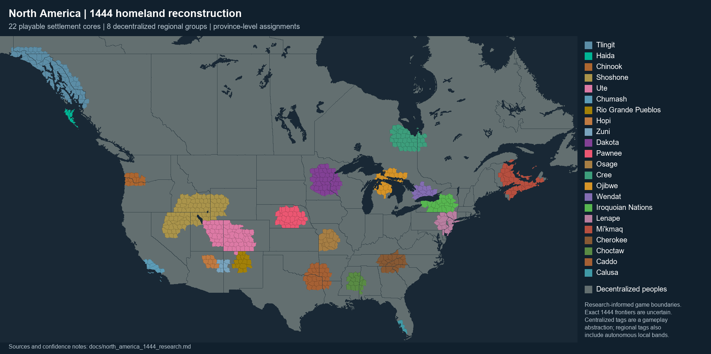

# North American homeland reconstruction for 1444

This revision replaces the initial geographic bands and imported later-era
territories with research-informed settlement cores for 22 playable tags,
including separate Hopi and Zuni countries.
It preserves eight decentralized regional tags and every province and person
in the existing 61-state scope. It is a reconstruction for a game, not a claim
that exact international borders or all twenty-two centralized governments existed
in 1444.

Cree now uses the independent tag `CRY`; the vanilla `IRC` identity is reserved
for a later Iron Confederacy formable, not a starting polity. The formable is
available to Cree or Ojibwe through the normal nation-formation system after
Nation Formation and Iron Weapons, while independent and at peace, with two
of the three listed Alberta/Saskatchewan/Manitoba formation regions controlled.
This is an alternate-history gameplay route, not a claim that the later
Cree-Assiniboine alliance existed in 1444. See the
[historical alliance context](https://opentextbc.ca/preconfederation2e/chapter/5-5-strategic-alliances/).

## Evidence and translation to provinces

Prefer evidence dated around 1400-1500, archaeological settlement sequences,
Indigenous nations' historical accounts, and museum/government research. Where
only later traditional-territory evidence is available, use it cautiously as
homeland context; do not label it a map of 1444. Later horse-era expansions,
colonial displacements, and modern reservation boundaries are not starting
ownership templates. Some ethnogenesis, migration, and confederacy chronologies
remain disputed. Confidence below distinguishes a homeland from its exact
political boundary.

The source-linked profiles are in
[`north_america_1444_homelands.json`](../tools/north_america_1444_homelands.json).
Their polygons were manually authored against the vanilla bitmap with the
coastline and named localities as anchors: Juneau/Sitka, Astoria/Portland,
Los Angeles/Fresno, Santa Fe/Albuquerque, Minneapolis/Aitkin, Toronto/Huntsville,
Syracuse/Albany, and Halifax/Fredericton, among others. They are not imported
historical GIS polygons and the listed sources do not assert these numeric
boundaries. A province enters a settlement core when its exact pixel centroid
falls inside its profile, subject to the state whitelist and documented local
exceptions. Whole states are never assigned to playable factions.

The final province identifiers are frozen in
[`north_america_1444_provinces.json`](north_america_1444_provinces.json).
The map below shows the implemented ownership, including province boundaries
within playable cores. Grey denotes eight separate regional decentralized tags,
not one country. Regional groups also represent autonomous bands of peoples
whose selected centralized core does not occupy their whole cultural homeland.
Hopi, Zuni and the Pueblo are separately playable, each with one
connected territory. Cree has a compact James Bay political core; outlying
Cree-inhabited lands are represented by autonomous bands in regional tags.

## Faction evidence and implemented territory

### Tlingit (TLG)

**77 provinces** in Alaska, British Columbia, Yukon Territory. Capital state: Alaska.

Southeast Alaska coast and archipelago from the Yakutat vicinity through Juneau/Sitka to the southern panhandle; a narrow adjacent inland fringe. Excludes interior Alaska. Later traditional maps do not establish an exact fifteenth-century frontier.

Confidence: moderate homeland; low exact 1444 boundary.

Sources: [source 1](https://learninglab.si.edu/collections/tlingit-people-and-their-culture/1pEvk720ueisQzlO), [source 2](https://guides.library.ubc.ca/indigtraditionalgovt/tlingit).

### Haida (X01)

**7 provinces** in British Columbia. Capital state: British Columbia.

Haida Gwaii only. Excludes the later expansion to Prince of Wales and Dall islands and excludes mainland British Columbia.

Confidence: strong island homeland; moderate province boundary.

Sources: [source 1](https://www.bctreaty.ca/council-haida-nation), [source 2](https://tile.loc.gov/storage-services/master/gdc/gdcebookspublic/20/20/71/95/21/2020719521/2020719521.pdf).

### Chinook (X83)

**13 provinces** in Oregon, Washington. Capital state: Washington.

Lower Columbia on both banks and its estuary, with the upriver Chinookan corridor. This umbrella is broader than the membership territory of the present Chinook Indian Nation; it does not include Puget Sound or eastern Washington.

Confidence: moderate.

Sources: [source 1](https://chinooknation.org/our-territory-chinook-indian-nation-vs-chinooka/), [source 2](https://ehrafworldcultures.yale.edu/cultures/nr06/description).

### Shoshone (SHH)

**92 provinces** in Idaho, Nevada, Utah, Wyoming. Capital state: Idaho.

Snake River/southern Idaho and central/eastern Great Basin settlement core, with a limited western Wyoming fringe. Excludes a later equestrian empire across the northern Plains and leaves Paiute/Goshute fringes decentralized. Numic migration chronology is uncertain.

Confidence: moderate to low.

Sources: [source 1](https://www.blm.gov/sites/default/files/documents/files/OwyBywayGuide_2016_web.pdf), [source 2](https://home.nps.gov/crmo/learn/education/history.htm), [source 3](https://files.cfc.umt.edu/cesu/NPS/UWY/2006/Harkin_DETO_Ethnography/NPSreportfinal.pdf).

### Ute (UTE)

**64 provinces** in Colorado, New Mexico, Utah. Capital state: Utah.

Eastern/central Utah, western Colorado and the upper San Juan/upper Rio Grande fringe. Focuses on mountain/plateau homelands rather than distant horse-era hunting grounds.

Confidence: moderate homeland; low exact political reach.

Sources: [source 1](https://www.southernute-nsn.gov/history/).

### Chumash (CMS)

**8 provinces** in California. Capital state: California.

San Luis Obispo/Santa Barbara/Ventura coastal core and represented northern Channel Islands. Excludes San Diego, most of the Los Angeles basin, and the inland Central Valley.

Confidence: moderate to strong homeland.

Sources: [source 1](https://sanctuaries.noaa.gov/media/chumash/2024-chnms-feis-vol-1.pdf), [source 2](https://santabarbaraca.gov/sites/default/files/2025-04/MEA%20Guidelines%20for%20Tribal%20Cultural%20Resources%20%26%20Appendices.pdf).

### Pueblo (PUE)

**15 provinces** in New Mexico. Capital state: New Mexico.

Rio Grande and Pajarito Plateau settlement cluster only. Hopi and Zuni are separate playable polities; the intervening desert remains decentralized.

Confidence: strong settlement regions; abstract political union.

Sources: [source 1](https://www.nps.gov/band/learn/historyculture/classic.htm).

### Hopi (HOP)

**9 provinces** in Arizona. Capital state: Arizona.

Hopi mesa settlement core around Awatovi and the northeastern Arizona villages. Kept separate from the Zuni and Rio Grande communities; the NPS documents Awatovi as already over 300 years old in 1540.

Confidence: strong settlement homeland; political unity is a gameplay abstraction.

Sources: [source 1](https://www.nps.gov/places/awatovi-ruins-arizona.htm), [source 2](https://www.hopi-nsn.gov/wp-content/uploads/2013/06/06052013_Tawaovi-EA-draft.pdf).

### Zuni (ZUN)

**8 provinces** in Arizona, New Mexico. Capital state: New Mexico.

Zuni River valley and its immediate Arizona/New Mexico border hinterland, separately playable from Hopi and the Rio Grande pueblos. Represents the ancestral Zuni settlements rather than a pan-Pueblo union.

Confidence: strong settlement homeland; exact provincial frontier approximate.

Sources: [source 1](https://sah-archipedia.org/buildings/NM-01-031-0161).

### Dakota (DKT)

**41 provinces** in Minnesota, Wisconsin. Capital state: Minnesota.

Mille Lacs, upper Mississippi and Minnesota woodland core with a western Wisconsin fringe. Removes later Lakota/Sioux Plains expansion from the Dakotas, Nebraska and Montana.

Confidence: moderate.

Sources: [source 1](https://www.mnhs.org/millelacs/learn/mille-lacs-band), [source 2](https://mn.gov/admin/archaeologist/the-public/mn-archaeology/contact-period/), [source 3](https://www.mnhs.org/fortsnelling/learn/bdote).

### Pawnee (PWN)

**30 provinces** in Nebraska. Capital state: Nebraska.

Loup/Platte and Republican River settlement belt in central Nebraska with a small northern Kansas fringe. Uses ancestral Pawnee association with late precontact settlements rather than a large nineteenth-century hunting range.

Confidence: moderate; ancestral affiliation partly inferred.

Sources: [source 1](https://history.nebraska.gov/marker-monday-pawnee/).

### Osage (O01)

**18 provinces** in Missouri. Capital state: Missouri.

Central/western Missouri and the Missouri/Osage riverways following the ancestral westward settlement shift around 1300-1350. Removes the broad Kansas/Oklahoma/Arkansas expansion associated with the eighteenth century.

Confidence: moderate to strong regional evidence.

Sources: [source 1](https://www.osagenation-nsn.gov/who-we-are/historic-preservation/osage-cultural-history), [source 2](https://www.kansashistory.gov/kansapedia/osage/19289).

### Cree (CRY)

**37 provinces** in Ontario, Quebec. Capital state: Ontario.

A compact southern James Bay/Moose River political core, with a limited adjacent Quebec shore. The wider western boreal territory returns to decentralized regional tags, including autonomous Cree bands. This deliberately does not equate Cree cultural presence with centralized political control across the Hudson Bay watershed.

Confidence: moderate homeland context; limited centralized reach is a gameplay choice.

Sources: [source 1](https://www.securitepublique.gc.ca/cnt/rsrcs/pblctns/cnqst-lw/index-en.aspx), [source 2](https://histindigenouspeoples.pressbooks.tru.ca/chapter/5-from-ice-age-to-contact/), [source 3](https://aeic-iaac.gc.ca/050/documents_staticpost/64144/83657/SocioEconomic_-_02_Historical_Context_FINAL.pdf).

### Ojibwe (OJB)

**23 provinces** in Michigan, Ontario. Capital state: Michigan.

Eastern Great Lakes/Mackinac-Sault-Manitoulin core. Removes Minnesota and Wisconsin territories associated with the later westward migration. Uses Ojibwe as the requested playable label for a narrower ancestral Anishinaabe grouping.

Confidence: moderate; broad Anishinaabe precursor representation.

Sources: [source 1](https://www.1854treatyauthority.org/images/LSOGGuide_FinalCommitteeApproval.pdf), [source 2](https://project.geo.msu.edu/geogmich/ojibwe.html).

### Wendat (WDT)

**15 provinces** in Ontario. Capital state: Ontario.

Simcoe Uplands plus ancestral village drainages on the north shore of Lake Ontario. Keeps ancestral settlements south of later concentrated seventeenth-century Wendake; excludes the Neutral core west of Lake Ontario.

Confidence: strong ancestral settlement regions; confederacy an abstraction.

Sources: [source 1](https://journals.plos.org/plosone/article?id=10.1371/journal.pone.0156178), [source 2](https://archaeologymuseum.ca/stories/the-history-of-ste-marie-ii/).

### Iroquoian Nations (IRO)

**21 provinces** in New York. Capital state: New York.

Five Nations ancestral central/western New York and Mohawk/Finger Lakes settlement belt. Excludes later Ohio/Great Lakes imperial claims and independent St Lawrence Iroquoian territories. Does not add the later Tuscarora membership.

Confidence: moderate core; confederacy chronology disputed.

Sources: [source 1](https://www.onondaganation.org/history/), [source 2](https://www.onondaganation.org/land-rights/), [source 3](https://journals.plos.org/plosone/article?id=10.1371/journal.pone.0156178).

### Lenape (L03)

**17 provinces** in Delaware, New Jersey, New York, Pennsylvania. Capital state: New Jersey.

Delaware Valley, eastern Pennsylvania, New Jersey and lower Hudson. Southern Delaware stays decentralized for Nanticoke representation. One peripheral New Jersey province represents autonomous Lenape bands to honor the requested no-whole-state rule, not a claim of non-Lenape ethnicity.

Confidence: strong homeland; political union an abstraction.

Sources: [source 1](https://nanticokelenapemuseum.org/museum/the-ancient-ones/), [source 2](https://dia.upenn.edu/en/content/LeechM001/).

### Mi'kmaq (MKQ)

**31 provinces** in New Brunswick, Quebec. Capital state: New Brunswick.

Nova Scotia, Cape Breton, PEI and eastern/northern New Brunswick with Gaspe. These are partly combined in the game's New Brunswick state. Leaves western New Brunswick to Wolastoqiyik-related decentralized peoples and Newfoundland to its precontact peoples rather than back-projecting later territorial associations.

Confidence: moderate homeland; low exact 1444 frontier.

Sources: [source 1](https://www.unsm.org/grand-council/pre-contact), [source 2](https://parks.canada.ca/lhn-nhs/ns/fortanne/culture/autochtone-indigenous/carte-mikmaki-map).

### Cherokee (CHE)

**24 provinces** in Georgia, North Carolina, South Carolina, Tennessee, Virginia. Capital state: Tennessee.

Southern Appalachian village core: eastern Tennessee, western North Carolina, northern Georgia and adjoining mountain valleys. Does not treat the full Kentucky/Virginia hunting range as directly administered territory.

Confidence: moderate ancestral core; ethnogenesis limits exact attribution.

Sources: [source 1](https://cherokee.gov/about-the-nation/frequently-asked-questions/history/), [source 2](https://motcp.org/learn/cherokee-history/).

### Choctaw (C03)

**16 provinces** in Alabama, Mississippi. Capital state: Mississippi.

Nanih Waiya/east-central Mississippi and a western Alabama fringe. Choctaw is a requested successor label for ancestral communities; a unified later Choctaw polity and post-removal Oklahoma boundaries are not asserted for 1444.

Confidence: moderate ancestral core; low exact 1444 political identity.

Sources: [source 1](https://www.choctawnation.com/wp-content/uploads/2016/09/sep2016-biskinik.pdf), [source 2](https://www.mdah.ms.gov/sites/default/files/2020-04/AR-27.pdf), [source 3](https://indigenousalabama.omeka.net/s/choctaw/page/halito).

### Caddo (C05)

**32 provinces** in Arkansas, Louisiana, Oklahoma, Texas. Capital state: Arkansas.

Late Caddo clusters on the Red River, northeast Texas/Neches-Sabine drainages, southwest Arkansas, southeast Oklahoma and northwest Louisiana. Excludes the Gulf delta and most of Arkansas and Oklahoma. Distinct Caddo societies are combined for the requested tag limit.

Confidence: strong Late Caddo core; political union an abstraction.

Sources: [source 1](https://www.texasbeyondhistory.net/tejas/ancestors/late.html), [source 2](https://texasbeyondhistory.net/tejas/fundamentals/timeline.html).

### Calusa (CLS)

**3 provinces** in Florida. Capital state: Florida.

Charlotte Harbor-Pine Island-Estero Bay-Mound Key and the southwest coastal fringe toward the Ten Thousand Islands. Excludes Atlantic Florida, the panhandle and a blanket claim over the whole southern peninsula.

Confidence: strong southwest core; wider tributary reach uncertain.

Sources: [source 1](https://pmc.ncbi.nlm.nih.gov/articles/PMC7165460/), [source 2](https://www.floridamuseum.ufl.edu/sflarch/research/calusa-cultural-heritage-preservation/).

## Local decisions and limits

- Upper Rio Grande settlement provinces take precedence where the broader Ute
  mountain envelope overlaps the Pueblo valley core. Both provinces are recorded
  individually in the assignment manifest.
- Sources identify all New Jersey as Lenape homeland. The peripheral province
  left decentralized represents politically autonomous Lenape bands; it is a
  gameplay decision required by the no-whole-state constraint, not historical
  evidence of another people holding that province.
- The Cree western chronology has competing interpretations. This playable core is
  now limited to southern James Bay, reducing its territory from 301 to 37
  provinces. Western boreal Cree bands are represented within decentralized
  regional tags; this does not deny their precontact presence.
- The Ojibwe tag represents an ancestral Anishinaabe eastern Great Lakes core.
  The cited ca. 1400 timeline is not evidence of a unified Ojibwe nation with
  these exact borders.
- Iroquoian Nations represents the ancestral Five Nations core. Independent
  St Lawrence, Neutral, Erie and other Iroquoian communities remain in regional
  decentralized tags. Wendat is separately playable as requested.
- Mi'kmaq territories in the Maritimes extend across Nova Scotia, Cape Breton,
  PEI and parts of New Brunswick/Gaspe. The game combines several of these areas
  into its `STATE_NEW_BRUNSWICK`, so that state name is not a modern border.
  Newfoundland stays decentralized rather than assuming the later recorded
  territorial distribution already applied in 1444.
- Choctaw and Cherokee are successor labels for ancestral cores; the evidence
  cannot resolve every fifteenth-century settlement's political affiliation.
  Contemporary national territory and heritage maps do not establish that the
  entire claimed cultural area was centrally ruled in 1444.
- Homelands extend beyond centralized settlement cores. Seasonal resource use,
  overlapping access and diplomatic relationships cannot be represented fully
  by assigning a single owner to each Victoria 3 province.

## Validation

The audit verifies all 22 playable and eight decentralized tags, no playable
whole-state ownership, exact agreement with the final province manifest,
allowed homeland regions, revised capital states, valid cultures and laws,
and population/building scope ownership. A province-adjacency check confirms
that Hopi, Zuni, the Pueblo and the smaller Cree core each have
a single connected land component. All **8,059 provinces** and
**3,120,593 population** are retained. Population composition by state, culture,
religion and pop type is unchanged; this is a border revision, not a researched
1444 population reconstruction.

Mexico, Mesoamerica, the Caribbean, Hawaii and Bermuda retain their prior
ownership. A new-game launch is still needed for runtime and selection-screen
verification. No performance benchmark or exact-frontier historical certainty
is claimed.
