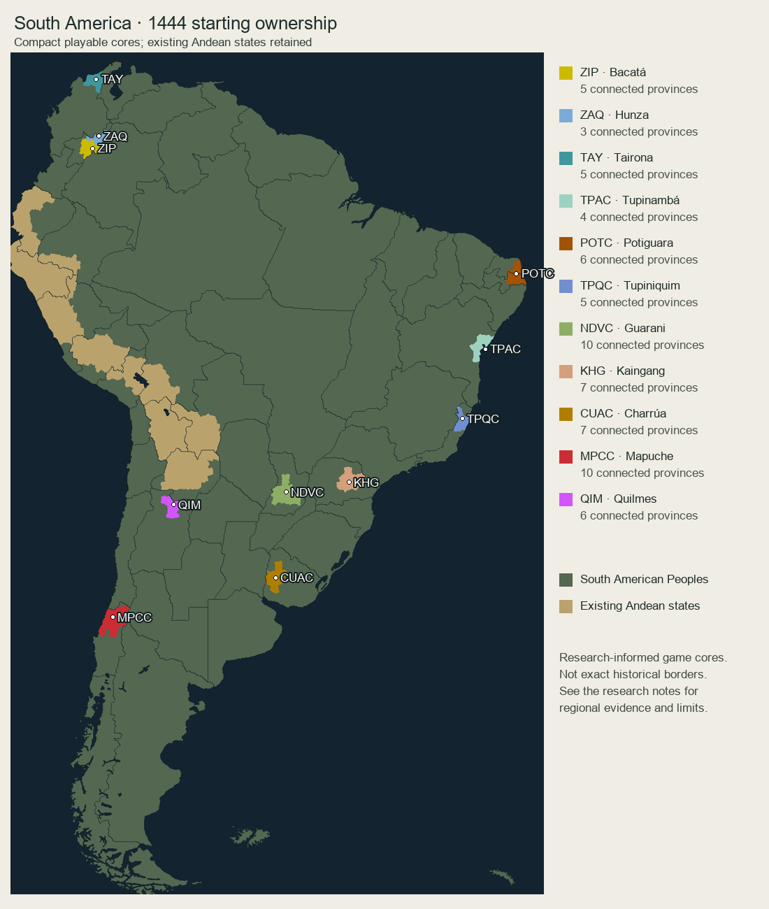

# South America, 1444: playable cores and decentralized consolidation

The setup retains every existing playable Andean country's province ownership.
Elsewhere, eleven compact native starts replace scattered token enclaves and
overextended ethnic territories. The remaining decentralized territory has one
owner, **South American Peoples (`AMZ`)**. This is explicitly a performance
abstraction encompassing independent communities, not a historical continental
state or a merged culture.

Active decentralized countries fall from **44 to one**. Total active South
American countries fall from **62 to 24**. The eleven regional cores contain
**68 provinces**; the complete revision covers **53 state regions and 3,691
provinces**. This reduces country/market overhead; frame-time improvement has
not been benchmarked.



## Playable choices

| Tag | Start | Provinces | Placement and purpose |
| --- | --- | ---: | --- |
| ZIP | Bacatá | 5 | Southern Muisca highlands around Bogotá; a rivalry with Hunza |
| ZAQ | Hunza | 3 | Northern Muisca highland core around Tunja |
| TAY | Tairona | 5 | Sierra Nevada de Santa Marta settlement network |
| TPAC | Tupinambá | 4 | Bahian coast, replacing the old Pará enclave |
| POTC | Potiguara | 6 | Paraíba/Rio Grande do Norte coast, replacing the Ceará-only start |
| TPQC | Tupiniquim | 5 | Espírito Santo coast inside vanilla's Rio de Janeiro region |
| NDVC | Guarani | 10 | Eastern Paraguay/Upper Paraná core, replacing the isolated Rio Grande do Sul enclave |
| KHG | Kaingang | 7 | Southern Jê uplands around the Tibagi plateau |
| CUAC | Charrúa | 7 | Eastern bank of the lower Uruguay, replacing the Buenos Aires enclave |
| MPCC | Mapuche | 10 | South-central Chile, excluding later expansion across the Pampas |
| QIM | Quilmes | 6 | Calchaquí valley core in Tucumán |

The generic playable **Tapuia (`AIMC`)** enclave is retired from the starting
map. Tapuia is an umbrella exonym, not a coherent local polity suited to that
Rio de Janeiro placement. The specific Kaingang regional start provides a
southern Jê alternative. Old inactive country definitions are retained where
possible, but no longer instantiate dozens of decentralized countries.

The map's internal names can be misleading: `STATE_LOS_RIOS` contains the
south-central Chilean Mapuche core, whereas `STATE_ARAUCANIA` is far south in
the vanilla geometry. Borders use actual province pixels, not assumptions based
on these labels.

## Research and uncertainty

These are **research-informed settlement cores**, inferred from archaeological
and early-contact evidence. No source supplies an exact 1444 political border
for every community. The selection algorithm grows a connected group of
provinces around a locality anchor within a limited regional mask; it does not
claim that every people formed a single centralized state. Modern reserves and
later horse-based territorial expansion are not used as 1444 borders.

* [Banco de la República: Muisca](https://enciclopedia.banrepcultural.org/index.php?title=Muisca)
  locates the eastern Cordillera's related communities and regional economy.
  [La vivienda Muisca](https://www.banrepcultural.org/biblioteca-virtual/credencial-historia/numero-335/la-vivienda-muisca)
  distinguishes the concentration of settlement around Bogotá and Tunja. These
  support separate highland cores, rather than the old Muisca reach into the
  eastern lowlands or the unused Zipa/Zaque capitals in Patagonia.
* [Banco de la República: Subregiones productivas del Caribe colombiano](https://www.banrep.gov.co/sites/default/files/publicaciones/archivos/lbr_subregiones.pdf)
  discusses Sierra Nevada settlements including Pueblito and Teyuna and their
  connected routes. Tairona is represented as a regional network, not a unified
  kingdom encompassing the whole Caribbean coast.
* Instituto Socioambiental's histories of the
  [Tupinambá](https://pib.socioambiental.org/pt/Povo%3ATupinamb%C3%A1),
  [Tupiniquim](https://pib.socioambiental.org/pt/Povo%3ATupiniquim),
  [Potiguara](https://pib.socioambiental.org/pt/Povo%3APotiguara),
  [Guarani](https://pib.socioambiental.org/pt/Povo%3AGuarani), and
  [Kaingang](https://pib.socioambiental.org/pt/Povo%3AKaingang) support the coastal,
  riverine and upland distinctions used here. Early-contact descriptions are
  projected cautiously backward; they are not treated as evidence of fixed
  modern ethnic states.
* [Arquivo Nacional: Charruas e minuanos](https://historialuso.an.gov.br/glossario/index.php/verbetes-glossario/14-verbetes-iniciados-em-c/1245-charruas-e-minuanos)
  supports an eastern Uruguay/Río de la Plata regional core. Later cattle-based
  expansion is excluded.
* [Museo Chileno de Arte Precolombino: Mapuche](https://museo.precolombino.cl/aprende/pueblos-culturas/pueblos-originarios/mapuche/)
  describes south-central Chilean regional groups and the later emergence of
  wider political solidarity. It dates the expansion into the Pampas to the
  seventeenth and eighteenth centuries, so the large Argentine footprint is removed.
* [Argentina's heritage account of Quilmes](https://www.argentina.gob.ar/viaja-por-argentina/que-hacer/caminar-por-la-ciudad-sagrada-de-quilmes)
  locates its substantial pre-Columbian settlement in the Calchaquí valleys.

The mod's existing culture groups remain shared proxies. `patagonian` includes
the Mapuche representation; `muisca` supplies a related Chibchan proxy for
Tairona; `aimara`/`quechua` remain the Quilmes proxy, not an assertion that the
Diaguita spoke those languages. Guarani now actually has Guarani primary culture.
Kaingang, Tairona and Tupiniquim also accept local groups already present in the
converter population. No pop's culture or religion is rewritten to manufacture
a homogeneous nation. A future culture overhaul can distinguish these identities
more precisely without revising the regional starting borders.

## Population, economy and playability

All **9,480,738** South American inhabitants are preserved by state, culture,
religion and population type. The migration repairs **61 populated orphan
history scopes** whose countries no longer owned any province in those states.
Their people remain in the same state and are allocated by current province
weights. These are distribution estimates, not new population research.

Territorial overlap allocates the other population. To avoid effectively empty
small-country starts, Kaingang receives 8,254 existing Paraná inhabitants and
Quilmes 7,878 existing Tucumán inhabitants from the aggregate owner. Both then
start with 12,000 people. This changes local settlement concentration while
preserving every state/culture/religion/type total. Every playable core has a
local primary-culture majority and owns its capital.

Founding technologies permit agriculture, woodcutting, pottery, legalism and
peasant levies. They do not grant European iron, cavalry, oceanic navigation or
an entire technology age. Existing regional building configurations are retained;
no industrial or financial windfall is added. Governments follow the mod's
existing early native baseline.

The frozen manifest, `south_america_1444.json`, records every old and new
province owner, source profile, population baseline, orphan-scope decision,
settlement adjustment and core adjacency. The source profiles and locality
anchors are in `tools/south_america_1444_profiles.json`.

## Validation and use

```powershell
node tools/audit_south_america.cjs
node tools/audit_map_ownership.cjs
node tools/audit_map_1_15.cjs
```

Checks cover connected cores, exact province coverage, unchanged Andean
playable territory, population conservation, buildings, capitals, laws,
technologies and primary-culture majorities. The global 1.15 audit overlays this
reviewed revision only after verifying that its original ownership matches the
earlier migration baseline. It still verifies all 312,807,718 people and 915
building configurations globally.

`south_america_map.py --index` builds temporary bitmap indexes for the one-time
setup script; running it without that flag renders the preview from the final
manifest. The setup script refuses to overwrite an existing manifest.

Use a **new campaign**. The checks do not substitute for an in-game load,
army/economy playtest, or performance benchmark.
